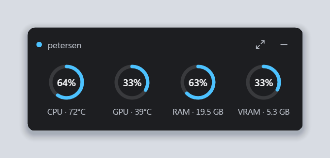
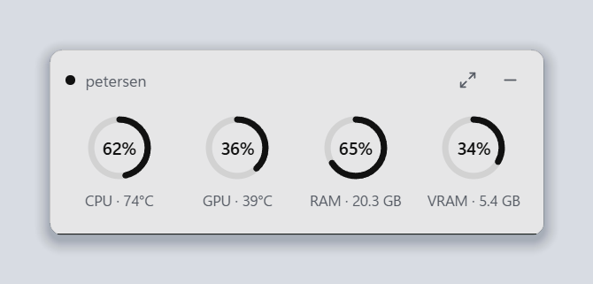
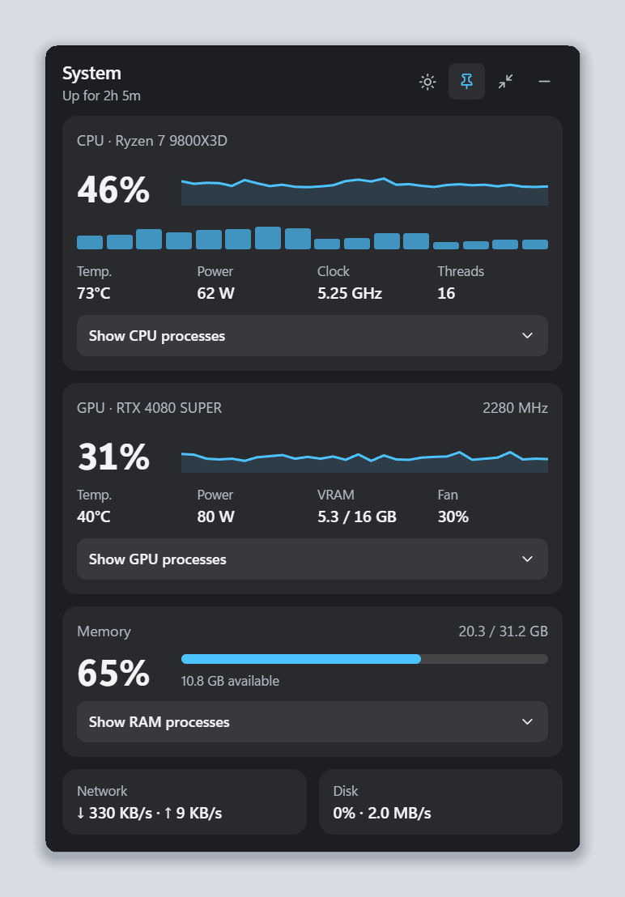
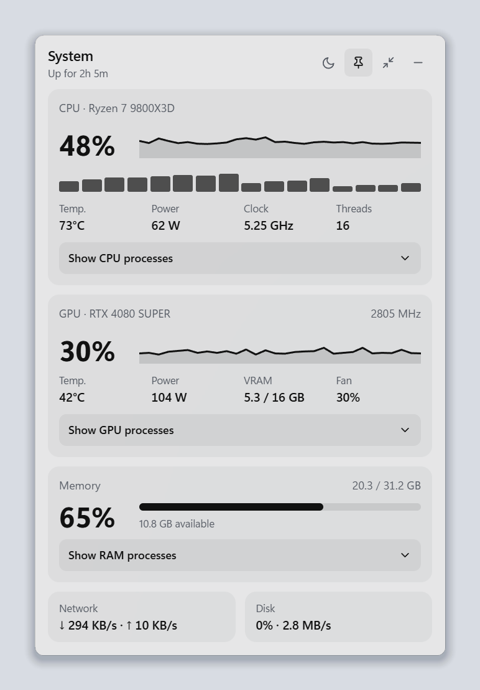

# Pulsar

A lightweight desktop widget that shows CPU, GPU, RAM, network and disk usage on Windows, Linux and macOS. Built with Tauri 2 (Rust) and Svelte.

<p align="center">
  
  
</p>

<p align="center">
  
  
</p>

- **Compact mode:** rings for CPU (with temperature or power), GPU (with temperature), RAM and VRAM.
- **Expanded mode:** history charts, per-thread usage, CPU temperature, power and clock, GPU details (temperature, power, VRAM, fan), network, disk, and the top processes by CPU, GPU or RAM, one click away.
- **Themes:** dark and light (sun/moon button), on top of the system backdrop (Mica on Windows 11, vibrancy on macOS).
- **Tray / menu bar icon:** click to show or hide the widget. The menu has "Always on top", "Start at login" and "Quit" (plus "CPU temperature" on Windows).
- **Languages:** English, or Portuguese when the system is set to Portuguese.

## Platform support

| | Windows 10/11 | Linux | macOS |
|---|---|---|---|
| CPU, RAM, processes, network | ✅ | ✅ | ✅ |
| CPU clock, disk activity | ✅ | ✅ | — |
| CPU power | ✅ | ✅ when RAPL is readable (often root-only) | — |
| CPU temperature | ✅ AMD and Intel, one-time setup (see below) | ✅ AMD and Intel, no setup | ✅ |
| NVIDIA GPU (usage, temperature, power, VRAM, fan) | ✅ | ✅ | — |
| AMD GPU | ✅ temperature, power %, fan, VRAM | ✅ usage, temperature, power, fan, VRAM | ✅ usage (Intel Macs) |
| Intel GPU | ✅ temperature, power %, VRAM | — | ✅ usage |
| Apple GPU | — | — | ✅ usage, memory in use |
| Top processes by GPU | ✅ | — | — |

Windows is the main target and is tested on real hardware. Linux and macOS builds are compiled on every push, but haven't been tested on real machines yet; reports are welcome.

## Install

Download the file for your system from the [Releases](../../releases) page, or the latest build from the [Actions](../../actions) tab:

- **Windows:** `Pulsar_x.y.z_x64-setup.exe`. Installs for the current user, so no admin rights are needed. Requires the WebView2 runtime, which ships with Windows 11.
- **Linux:** `.deb` (Debian, Ubuntu), `.rpm` (Fedora, openSUSE) or `.AppImage` (any distribution). The `.deb` and `.rpm` open in the system's software installer with a double click. On GNOME without the AppIndicator extension (Fedora's default), the tray icon doesn't show; the widget still works, and opening Pulsar again brings it back after it's hidden.
- **macOS:** `.dmg`. The app isn't signed yet, so the first time open it with right click › Open.

### CPU temperature on Windows (AMD Ryzen, Intel Core)

Windows doesn't expose the CPU temperature to regular programs. Pulsar reads it from the processor through the free, signed [PawnIO](https://pawnio.eu/) driver, which needs administrator rights.

When the temperature is off, a thermometer icon shows up in the widget. Click it and accept the administrator prompt once. Pulsar then registers a small helper that starts at logon and reads only the temperature register, so the widget itself keeps running without admin rights. If PawnIO isn't installed, the same icon opens its website.

The helper runs from a copy under `C:\Program Files\Pulsar`, which only administrators can modify. You can turn it off again from the tray menu.

On Linux and macOS the temperature comes from the system sensors and needs no setup.

## Build

```sh
npm install
npm run tauri dev       # development
npm run tauri build     # installer for the current system in src/core/target/release/bundle
```

On Linux, install the WebKitGTK and tray dependencies first (Debian/Ubuntu):

```sh
sudo apt install libwebkit2gtk-4.1-dev libayatana-appindicator3-dev librsvg2-dev patchelf
```

## Releasing

```sh
npm run release -- patch                       # 0.3.0 -> 0.3.1, all platforms
npm run release -- minor --platforms windows   # only the Windows installer
npm run release -- 1.0.0 --platforms windows,linux
npm run release -- patch --dry-run             # show what would happen
```

Pulsar updates itself: it checks the latest published release shortly after starting and every 6 hours, and shows an update icon when a newer version exists. Clicking it downloads, installs and restarts. Updates are signed; the release workflow signs them with the `TAURI_SIGNING_PRIVATE_KEY` and `TAURI_SIGNING_PRIVATE_KEY_PASSWORD` repository secrets, and the app only accepts packages signed with that key (its public half is in `tauri.conf.json`). Losing the private key means installed copies can no longer update, so keep a backup of it.

The command bumps the version in `package.json`, `package-lock.json`, `tauri.conf.json`, `Cargo.toml` and `Cargo.lock`, commits `Release x.y.z`, tags `vx.y.z`, pushes both, and starts the Release workflow. The workflow builds the installers of the chosen platforms and attaches them to a draft release, which is published after a quick look (`gh release edit vx.y.z --draft=false`). Regular commits only run the Build workflow.

## Project layout

```
src/
├── ui/                Svelte interface: routes, components, styles
└── core/              Rust (Tauri): window, tray, data collection
    └── src/platform/  per-OS data: windows.rs, linux.rs, macos.rs
```

## Data sources

| Data | Source |
|---|---|
| CPU, RAM, processes, network (all) | `sysinfo` crate |
| NVIDIA GPU (Windows, Linux) | NVML via `nvml-wrapper` |
| AMD and Intel GPUs (Windows) | D3DKMT adapter performance data (the same source Task Manager uses) |
| Clock, disk, per-process GPU usage (Windows) | PDH performance counters |
| CPU power (Windows) | "Energy Meter" counters (RAPL), no driver needed |
| CPU temperature (Windows) | PawnIO driver with its signed `AMDFamily17` module (Tctl register) or `IntelMSR` module (package thermal status) |
| CPU temperature, clock, power, disk (Linux) | hwmon (`k10temp`, `zenpower`, `coretemp`), cpufreq, RAPL powercap, `/proc/diskstats` |
| AMD GPU (Linux) | `amdgpu` sysfs files |
| CPU temperature (macOS) | System sensors through `sysinfo` |
| GPU (macOS) | IOKit `IOAccelerator` performance statistics |

The sampler (`src/core/src/sampler.rs`) runs once per second and only collects what is on screen:
- **Compact mode:** totals only.
- **Process list open:** that list's processes too.
- **Hidden in the tray:** nothing at all, and on Windows the WebView switches to its low-memory mode.

## Performance notes

- Value transitions use `steps(8)` instead of smooth easing. With continuous transitions the WebView repainted at 60–144 fps after every update, which cost about 25% of a core on a 4K display. With steps it costs about 3%.
- The window is sized in physical pixels from the WebView's own `devicePixelRatio`, which can differ from the window scale factor on mixed-DPI multi-monitor setups.

Measured on Windows 11 with a Ryzen 7 9800X3D and an RTX 4080 SUPER on a 4K display:

| State | CPU (of all threads) | Private memory |
|---|---|---|
| Compact | ~0.2% | ~200 MB |
| Expanded with the GPU process list open | ~0.4–0.6% | ~240 MB |
| Hidden in the tray | ~0% | ~220 MB |

Most of the memory belongs to WebView2. The Rust process itself uses about 35 MB.

## Third-party

`src/core/resources/pawnio/AMDFamily17.bin` and `IntelMSR.bin` are signed modules from [PawnIO.Modules](https://github.com/namazso/PawnIO.Modules), licensed under LGPL-2.1 (see `COPYING-LGPL-2.1` next to it).
